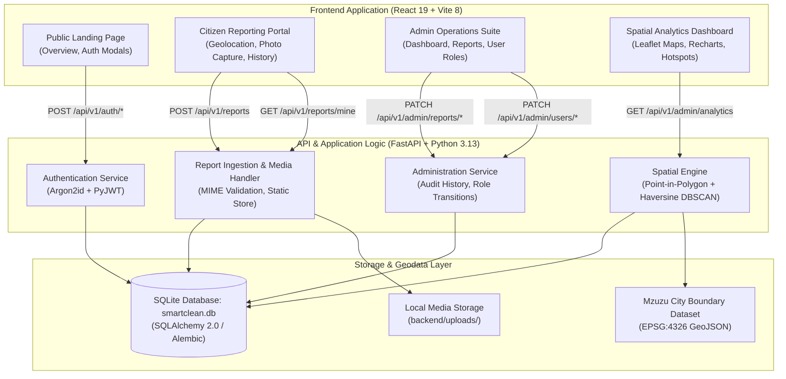
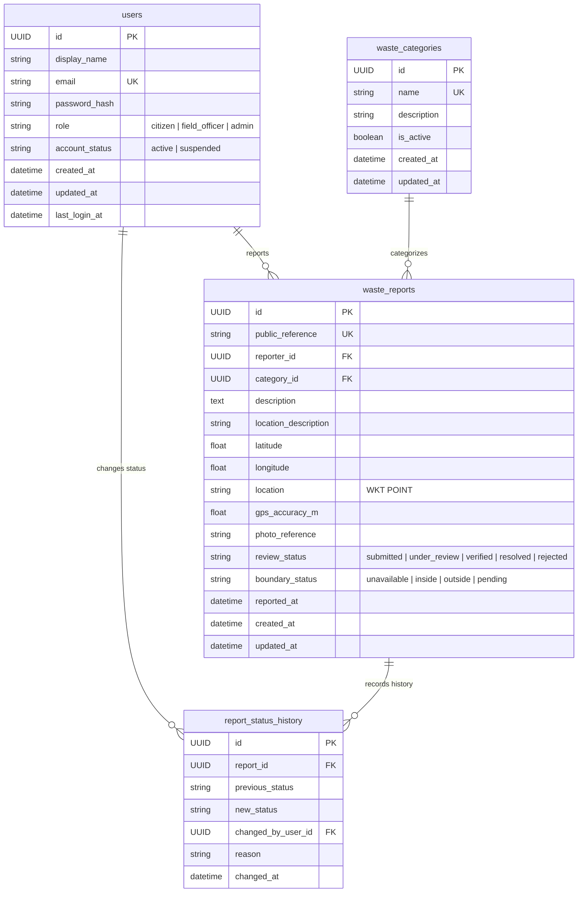
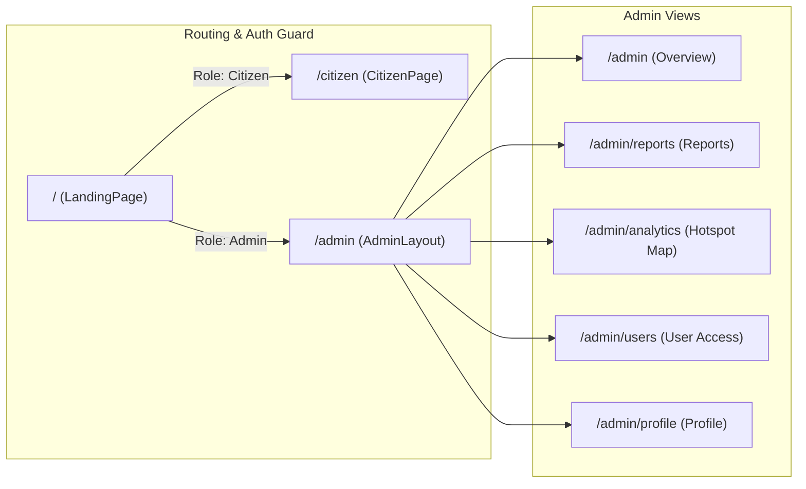

# Mzuzu SmartClean — Comprehensive System Documentation

## 1. Executive Summary & Domain Context

**Mzuzu SmartClean** is a full-stack, spatial-intelligence waste reporting and management system developed for **Mzuzu City, Northern Malawi**. In many developing urban centers, municipal waste collection authorities face severe logistical bottlenecks due to irregular reporting, lack of real-time geolocated data, illegal open dumpsites, and inefficient vehicle dispatching.

The system addresses this through a participatory sensing paradigm:
1. **Citizens** act as active environmental monitors by capturing geo-referenced reports of waste accumulation with photos and GPS coordinates.
2. **Municipal Administrators & Field Teams** manage verification and collection workflows through an administrative management portal.
3. **Spatial Density Clustering (DBSCAN)** groups individual reports into persistent "waste hotspots," distinguishing acute spatial clusters from isolated noise and providing the algorithmic basis for municipal route optimization.

---

## 2. System Architecture

The system is constructed with a decoupled, three-tier service architecture comprising a client web application, an asynchronous REST API, and a spatial persistence layer.



### Technology Stack Summary

| Subsystem | Technology | Purpose & Rationale |
| :--- | :--- | :--- |
| **Frontend Framework** | React 19.2 + Vite 8.3 | High-performance reactive rendering with fast bundling. |
| **Routing** | React Router DOM 7.18 | Declarative client-side routing with role-based Route Guards. |
| **Mapping Engine** | Leaflet 1.9 + React Leaflet 5.0 | GeoJSON boundary rendering, custom marker clustering, and coordinate manipulation. |
| **Data Visualization** | Recharts 3.10 | Responsive SVG charting for category frequencies and status breakdowns. |
| **Backend Framework** | FastAPI 0.115 (Python 3.13) | Asynchronous, OpenAPI-compliant REST API with Pydantic validation. |
| **ORM & Migrations** | SQLAlchemy 2.0 + Alembic 1.14 | Typed entity mapping with schema migration lifecycle management. |
| **Database** | SQLite 3 (Dev) / PostgreSQL (Target) | Zero-configuration local database; models use WKT POINT for seamless PostGIS migration. |
| **Security & Auth** | Argon2-cffi 23.1 + PyJWT 2.10 | Memory-hard password hashing with cryptographically signed bearer tokens. |

---

## 3. Data Models & Entity Relationships

The schema is normalized to guarantee transactional integrity, auditability, and spatial indexing.



### Table Specifications

#### 1. `users`
- Stores authentication credentials and role assignments.
- Enforces unique email constraints and enum constraints on `role` and `account_status`.
- Passwords are encrypted using Argon2id (`argon2-cffi`).

#### 2. `waste_categories`
- Stores administrative categorization for waste types.
- Seeded with three defaults:
  1. *Full dustbin or overflowing collection point*
  2. *Indiscriminate waste disposal*
  3. *Waste disposal where no dustbin is available*

#### 3. `waste_reports`
- Core entity containing geographic coordinate pairs (`latitude`, `longitude`) with check constraints:
  - Latitude: \([-90.0, 90.0]\)
  - Longitude: \([-180.0, 180.0]\)
  - Non-negative GPS accuracy: \(\text{accuracy} \ge 0\)
- Stores a Well-Known Text (WKT) representation `POINT(longitude latitude)` for portable spatial compatibility.
- Indexes: Composite B-tree index on `(latitude, longitude)` and `(review_status, reported_at)`.

#### 4. `report_status_history`
- Immutable append-only audit trail capturing every state transition across the lifecycle.
- Records timestamp, acting user UUID, previous status, next status, and justification reason.

---

## 4. API Reference & Contract

Base URL: `http://127.0.0.1:8000/api/v1`

### Authentication Endpoints (`/auth`)

| Method | Endpoint | Access | Request Body | Response | Description |
| :--- | :--- | :--- | :--- | :--- | :--- |
| `POST` | `/auth/register` | Public | `{ display_name, email, password }` | `{ access_token, token_type, user }` | Registers a citizen user. Role defaults strictly to `citizen`. |
| `POST` | `/auth/login` | Public | `{ email, password }` | `{ access_token, token_type, user }` | Verifies credentials with Argon2 and issues an HMAC-SHA256 JWT. |
| `GET` | `/auth/me` | Bearer Token | *None* | `UserOut` | Returns profile of currently authenticated user. |

### Categories & Citizen Reports (`/categories`, `/reports`)

| Method | Endpoint | Access | Request Body | Response | Description |
| :--- | :--- | :--- | :--- | :--- | :--- |
| `GET` | `/categories` | Public | *None* | `list[CategoryOut]` | Returns all active waste classification categories. |
| `POST` | `/reports` | Citizen/Admin | `ReportCreate` (JSON) | `ReportCreated` | Creates a new waste report, validates boundary, stores photo. |
| `GET` | `/reports/mine` | Citizen | *None* (query `limit`) | `list[ReportAdminOut]` | Retrieves submission history for the authenticated user. |
| `GET` | `/reports/reference/{ref}` | Public | *None* | `ReportStatusOut` | Public reference tracking endpoint (e.g. `MSC-XXXXX`). |

> [!NOTE]
> Report creation accepts photos either as pre-uploaded references or as raw Base64 data URLs (`image/jpeg`, `image/png`, `image/webp` up to 5 MB). The server validates magic bytes, decodes the stream, generates a collision-resistant filename (`{user_id}-{hex}.ext`), and stores it in `backend/uploads/`.

### Administrative Operations (`/admin/*`)

| Method | Endpoint | Access | Query / Params | Response | Description |
| :--- | :--- | :--- | :--- | :--- | :--- |
| `GET` | `/admin/reports` | Admin | `page`, `page_size`, `status`, `category_id` | `Page[ReportAdminOut]` | Paginated review list of all citizen reports. |
| `PATCH` | `/admin/reports/{id}/status` | Admin | `{ status, reason }` | `ReportAdminOut` | Updates review status and commits an audit log entry. |
| `GET` | `/admin/users` | Admin | `page`, `page_size` | `Page[UserOut]` | Lists all registered accounts in the system. |
| `PATCH` | `/admin/users/{id}/role` | Admin | `{ role }` | `UserOut` | Changes user privileges (`citizen`, `field_officer`, `admin`). |
| `GET` | `/admin/analytics` | Admin | *None* | `AnalyticsOut` | Executes point-in-polygon and DBSCAN clustering. |

### Health Check Endpoints (`/health`)

| Method | Endpoint | Description |
| :--- | :--- | :--- |
| `GET` | `/health` | Process liveness probe; returns `{ "status": "ok" }`. |
| `GET` | `/health/ready` | Readiness probe; validates live connectivity to the SQLite database. |

---

## 5. Spatial Analytics & Hotspot Detection Engine

The core data science capability of Mzuzu SmartClean is encapsulated in [`backend/app/api/routes/analytics.py`](file:///c:/Users/lumbani/Desktop/mzuzu-smartclean/backend/app/api/routes/analytics.py) and prototyped in [`machine_learning_model/BDSCKAN.ipynb`](file:///c:/Users/lumbani/Desktop/mzuzu-smartclean/machine_learning_model/BDSCKAN.ipynb).

### A. Point-in-Polygon (PIP) Boundary Validation
The city boundary is provided in [`backend/data/mzuzu_boundary.geojson`](file:///c:/Users/lumbani/Desktop/mzuzu-smartclean/backend/data/mzuzu_boundary.geojson) (EPSG:4326 polygon defining Mzuzu City, Administrative Code `MW107`).

Validation uses the **Ray-Casting Algorithm**:
For a given coordinate point \((x_0, y_0)\) where \(x\) is longitude and \(y\) is latitude, a semi-infinite ray extends eastward along the horizontal axis. For each line segment \((p_1, p_2)\) of the polygon ring:
- An intersection occurs if \((y_1 > y_0) \neq (y_2 > y_0)\) and:
  $$x_0 < \frac{(x_2 - x_1)(y_0 - y_1)}{y_2 - y_1} + x_1$$
- The point is inside the polygon if and only if the total number of ray intersections with polygon edges is odd.
- MultiPolygon outer and inner hole rings are fully supported.

### B. Great-Circle Distance Metric (Haversine)
Because Euclidean coordinate calculations (\(\sqrt{\Delta x^2 + \Delta y^2}\)) introduce distortion over spherical surfaces, spatial separation between two reports \(P_1(\phi_1, \lambda_1)\) and \(P_2(\phi_2, \lambda_2)\) is computed via the **Haversine Formula**:

$$a = \sin^2\left(\frac{\Delta\phi}{2}\right) + \cos(\phi_1)\cos(\phi_2)\sin^2\left(\frac{\Delta\lambda}{2}\right)$$
$$d = 2 R \arcsin\left(\sqrt{a}\right)$$

where \(R = 6371.0088\text{ km}\) is the volumetric mean Earth radius, and \(\phi, \lambda\) are latitudes and longitudes in radians.

### C. DBSCAN Hotspot Clustering Algorithm
**Density-Based Spatial Clustering of Applications with Noise (DBSCAN)** is applied to all reports located within the municipal boundary.

#### Parameter Calibration:
- \(\varepsilon\) (Neighborhood Radius): `0.20 km` (\(200\text{ meters}\)). Reflects typical walking radius and micro-catchment for illegal dumping.
- \(\text{MinSamples}\): `3 reports`. Requires at least three independent complaints to establish a recognized hotspot.

#### Classification Rules:
1. **Core Point**: A report with at least \(\text{MinSamples}\) reports within distance \(\varepsilon\).
2. **Border Point**: A report within \(\varepsilon\) of a Core Point, but with fewer than \(\text{MinSamples}\) neighbors itself.
3. **Noise / Isolated Point (Cluster \(-1\))**: A report that is neither a Core Point nor a Border Point.
4. **Hotspot Cluster**: A maximal set of density-connected reports. For each cluster \(C_k\), the API calculates:
   - **Centroid Coordinates**:
     $$\bar{\phi}_k = \frac{1}{|C_k|}\sum_{i \in C_k}\phi_i, \quad \bar{\lambda}_k = \frac{1}{|C_k|}\sum_{i \in C_k}\lambda_i$$
   - **Report Frequency**: \(|C_k|\)
   - **Waste Breakdown**: Category distribution within cluster \(C_k\).

---

## 6. Frontend User Interface Architecture



### Module Breakdown

1. **[`LandingPage.jsx`](file:///c:/Users/lumbani/Desktop/mzuzu-smartclean/src/LandingPage.jsx)**:
   - Hero banner featuring Mzuzu City imagery with localized advocacy points.
   - Dynamic credentials card switching between Sign-In, Sign-Up, and Password Reset guidance.
   - Header theme switcher toggling root CSS variables.

2. **[`CitizenPage.jsx`](file:///c:/Users/lumbani/Desktop/mzuzu-smartclean/src/citizen/CitizenPage.jsx)**:
   - One-click GPS location capture utilizing the browser's `navigator.geolocation` API with accuracy meters readout.
   - Interactive camera / file picker with instant Base64 photo preview.
   - Personal reports timeline showing public reference tokens (`MSC-...`), timestamps, and color-coded status badges (`submitted`, `under_review`, `resolved`).

3. **[`AdminDashboard.jsx`](file:///c:/Users/lumbani/Desktop/mzuzu-smartclean/src/admin/AdminDashboard.jsx)**:
   - Key Performance Indicator (KPI) summary cards (`Total Reports`, `Pending`, `Resolved`, `Active Hotspots`).
   - Quick-glance recent activity feed and status breakdown progress bars.

4. **[`Reports.jsx`](file:///c:/Users/lumbani/Desktop/mzuzu-smartclean/src/admin/Reports.jsx)**:
   - Administrative review table displaying photo thumbnails, descriptions, coordinates, and report references.
   - In-line dropdown status editor allowing direct state promotions (`submitted` &rarr; `under_review` &rarr; `resolved`).

5. **[`Analytics.jsx`](file:///c:/Users/lumbani/Desktop/mzuzu-smartclean/src/admin/Analytics.jsx)**:
   - **Interactive Leaflet Map**:
     - Visualizes the official Mzuzu City GeoJSON boundary in green stroke.
     - Renders Hotspot centroids with dynamic radius proportional to sample volume.
     - Renders individual report markers categorized by color.
     - Layer control checkboxes: Toggle Boundary, Clusters, Points, and Noise.
     - Fit City Bounds / Reset Zoom buttons.
   - **Analytical Visualizations**:
     - Recharts Pie Chart: Category distribution of reported waste.
     - Recharts Bar Chart: Top hotspots ordered by complaint density.
     - Metric cards: Clustered complaint percentage vs isolated noise.

6. **[`ManageUsers.jsx`](file:///c:/Users/lumbani/Desktop/mzuzu-smartclean/src/admin/ManageUsers.jsx)**:
   - User table showing join dates, account status, and role badges.
   - Instant role promotion/demotion between `citizen`, `field_officer`, and `admin`.

---

## 7. Security Architecture & Threat Mitigation

| Security Aspect | Implementation Detail |
| :--- | :--- |
| **Password Storage** | Argon2id hashing algorithm via `argon2-cffi` with time/memory cost parameters preventing GPU brute-force attacks. |
| **Token Authentication** | Signed JWT bearer tokens with expiration window (`access_token_minutes = 60`), signed by a 32+ character `SECRET_KEY`. |
| **Access Control (RBAC)** | FastAPI dependencies (`require_admin`, `get_current_user`) enforcing authorization at the endpoint level. Public registration is strictly restricted from assigning privileged roles. |
| **Input Sanitization** | Pydantic v2 data models enforcing strict coordinate boundaries (\([-90, 90]\), \([-180, 180]\)), string length bounds, and email format verification. |
| **File Upload Defense** | File size capped at 5 MB; MIME types checked against magic headers (`image/jpeg`, `image/png`, `image/webp`); files saved with randomized cryptographic UUIDs to prevent directory traversal. |
| **CORS Policy** | Restricted CORS middleware explicitly whitelisting authorized origins (`http://localhost:5173`). |

---

## 8. Development, Testing & Operational Guide

### Prerequisites
- Python 3.11+ (Tested on Python 3.13.9)
- Node.js 18+ & npm 9+
- Windows PowerShell / Linux Bash

### Step-by-Step Installation

#### 1. Backend Environment Setup
```powershell
Set-Location backend
python -m venv .venv
.\.venv\Scripts\Activate.ps1
python -m pip install --upgrade pip
python -m pip install -r requirements.txt
Copy-Item .env.example .env
```

Ensure `backend/.env` contains:
```env
APP_NAME="Mzuzu SmartClean API"
APP_ENV="development"
DATABASE_URL="sqlite:///./smartclean.db"
CORS_ORIGINS=["http://localhost:5173"]
SECRET_KEY="replace-with-a-secure-random-32-char-secret-string"
ACCESS_TOKEN_MINUTES=60
SEED_DEFAULT_ACCOUNTS=true
```

#### 2. Start the Backend API
```powershell
$env:PYTHONPATH = "."
uvicorn app.main:app --reload --host 127.0.0.1 --port 8000
```
- Swagger Interactive Documentation: `http://127.0.0.1:8000/docs`
- ReDoc Documentation: `http://127.0.0.1:8000/redoc`

#### 3. Frontend Setup & Launch
```powershell
# From project root
npm install
npm run dev
```
- Frontend application runs at: `http://localhost:5173`

#### 4. Running Backend Tests
Execute the pytest test suite from the project root:
```powershell
$env:PYTHONPATH = "backend"
backend\.venv\Scripts\pytest backend\tests -v
```

---

## 9. Production Migration Roadmap

> [!IMPORTANT]
> The current system is in a functional development stage using SQLite. Before deploying into production for the Mzuzu City Council, complete the following milestones:

1. **PostgreSQL / PostGIS Transition**:
   - Migrate database driver from `sqlite` to `psycopg3` on PostgreSQL 18.
   - Install PostGIS extension on the host server: `CREATE EXTENSION postgis;`.
   - Update `WasteReport.location` from string WKT to native `geometry(Point, 4326)` with a spatial GiST index (`CREATE INDEX ix_reports_geom ON waste_reports USING GIST(geom);`).
   - Replace Python ray-casting with PostGIS native spatial functions: `ST_Contains(boundary.geom, report.geom)` and `ST_ClusterDBSCAN(geom, eps := 0.0018, minpoints := 3) OVER()`.
2. **Object Storage Integration**:
   - Replace local disk uploads (`backend/uploads/`) with S3-compatible cloud object storage (e.g. AWS S3, Cloudflare R2, or MinIO) with pre-signed upload URLs.
3. **SMS / USSD Reporting Interface**:
   - Incorporate an SMS gateway (e.g., Africa's Talking) to allow non-smartphone residents in Mzuzu to report waste via USSD menus or shortcodes.
4. **Route Optimization (Vehicle Routing Problem - VRP)**:
   - Feed detected DBSCAN hotspot centroid coordinates into an Open Source Routing Machine (OSRM) or Google OR-Tools solver to calculate shortest-path collection truck dispatch schedules.
